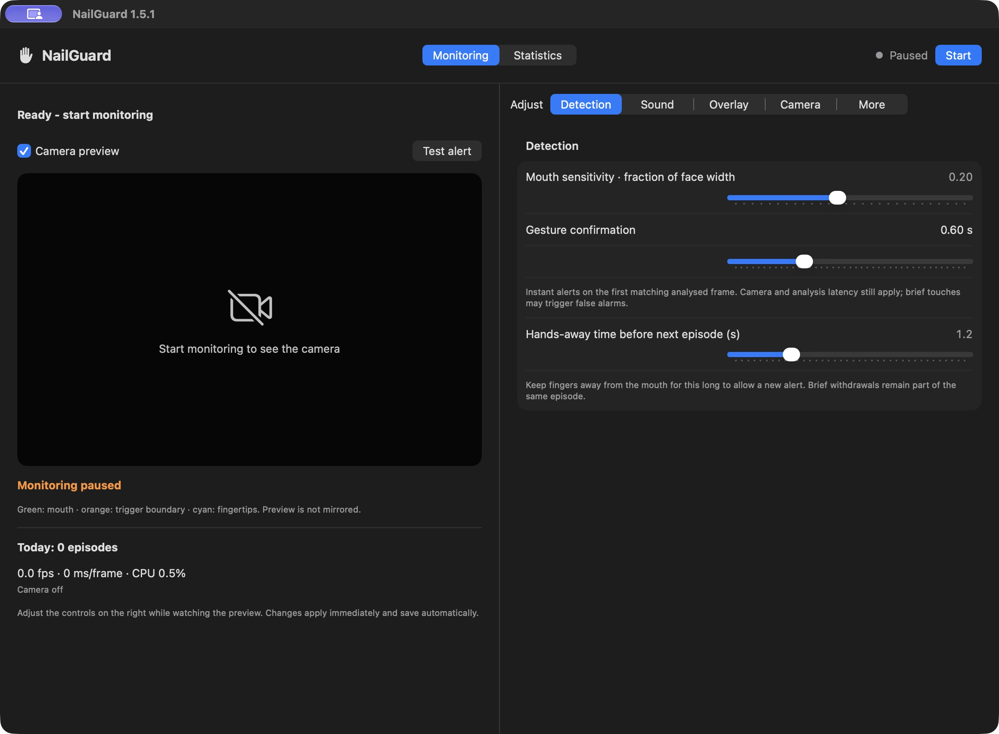

<p align="center"></p>
<h1 align="center">NailGuard</h1>
<p align="center">A small reminder to keep your hands away from your mouth.</p>
<p align="center"><a href="https://github.com/Szalikko/NailGuard/raw/refs/heads/main/Downloads/NailGuard-macOS-arm64.zip"><strong>Download for Apple Silicon</strong></a></p>



NailGuard is a native macOS menu bar app that uses your camera to detect fingertips near your mouth. It plays a sound and shows an optional overlay to help you notice the gesture.

### Features

- Live camera preview with mouth and fingertip markers.
- Adjustable sensitivity, Instant detection and repeat alerts.
- Sound previews, overlay styles, screen positioning and dimming.
- Local event history, optional snapshots and hourly/date-range statistics.
- Three processing resolutions, adaptive analysis and CPU readout.
- Launch at login, quick pause and data cleanup controls.

**Private by design:** camera analysis runs on your Mac. No cloud, account, uploads or video recording. Optional photos stay local and have configurable retention limits.

### Get started

Requires **Apple Silicon and macOS 14 or later**. Tested on an M1 Pro running macOS 27.2.

1. Download version 1.6.1 using the link above, unzip it and move `NailGuard.app` to Applications.
2. Open it, allow camera access and click **Start**.
3. Tune the detection while watching the preview. Try **Eco** first for lower resource use.

The app is locally signed, not notarized by Apple. macOS may require **System Settings > Privacy & Security > Open Anyway** after the first launch attempt. Only do this if you trust the source, or build it yourself.

### Build from source

Install Xcode Command Line Tools, then run:

```sh
zsh build.command
```

This builds `NailGuard.app` for Apple Silicon, signs it locally and runs the regression tests. All build resources are included.

Detects proximity, not confirmed nail biting. Lighting, occlusion and head movement affect accuracy. The screenshot shows an earlier version of the real app with the camera disabled and no personal data loaded.

<sub>Icon image supplied by the project owner.</sub>
